<p align="center">
  
</p>

<h1 align="center">Greenlit</h1>

<p align="center"><b>Footage, review and publishing for a studio that films its work.</b><br>
A self-hosted media library, review room, social publishing desk and live-preview video editor —
built so people and AI agents (Claude Code first) can work in it side by side.</p>

---

## What it does

- **Library** — projects with media, edits and posts. Every media item holds several **formats** of the same content
  (16:9 main, 9:16 vertical, 1:1 square…) instead of near-duplicate files, **versions** of it (the same video with
  Italian or English text, each with its own formats) and extra **audio tracks** (a voice-over in another language)
  that a post can use in place of the video's own sound. Thumbnails, hover-scrub previews,
  waveforms, EXIF dates and places are made automatically. Token search (`status:`, `kind:`, `#tag`, `project:`),
  drag-select, bulk actions, drop-to-upload, right-click menus on everything.
- **Review** — reviewers click a spot of the frame (or drag an area) at an exact moment of the video to leave a note,
  attach library media, files or pasted pictures, and greenlight or ask for changes as a checklist. Admins mark notes
  done, send work for review, approve it themselves, and can hide items from specific reviewers.
- **Everything is versioned** — titles, notes, tags, formats, files, posts and edits keep a full history you can
  compare, name, annotate and restore.
- **Editor** — a lightweight timeline editor where compositions play live in the browser, _without rendering_:
  video, pictures, audio, text, shapes and code layers (any HTML/CSS/JS animation, seeked frame by frame), keyframes,
  transitions, per-format reframing. Claude edits the same document through MCP and every open editor updates
  instantly; the page also exposes `window.greenlit.editor` for browser agents. Exports are frame-exact and land in
  the library as formats of one item.
- **Publishing** — posts for Instagram, Facebook, TikTok and YouTube with per-platform captions, titles, tags,
  covers, translations, music from the platform's own library, audio mix, options, and schedules held **on the
  platforms themselves**. Files are re-encoded with each placement's preferred settings. Interactive previews emulate
  each app. A calendar shows everything; edits flow both ways with the platforms. You sign in with the accounts you
  already use — no developer apps ([docs/CONNECTORS.md](docs/CONNECTORS.md)).
- **Share links** — single-use links that sign a person in to one post, item or project, with an expiry.
- **Map & globe** — projects and media on an interactive map with a 3D globe mode and animated search.
- **Storage** — usage overview and automatic archival of old media (per file, so each stays downloadable, deletable
  and restorable), keeping thumbnails and previews browsable.
- **Your brand** — theme packs (palettes, fonts, radius; a Studio Associato GEM theme included), branding (name,
  logos, favicon, sign-in picture), platform time zone, English and Italian.
- **API & MCP** — a documented REST API (OpenAPI at `/api/openapi.json`, reference at `/api/docs`) and an MCP server
  at `/api/mcp` that exposes the whole platform to Claude Code and other agents.

## Quick start (Docker)

```bash
cp .env.example .env        # set GREENLIT_SECRET (openssl rand -hex 32), GREENLIT_PUBLIC_URL, CLOUDFLARE_TUNNEL_TOKEN
docker compose up -d --build
```

One compose project runs everything: the app, its database, Greenlit's own Android device (an emulator with a
virtual camera, for what only a platform's Android app does) and, when `.env` has a token, the Cloudflare Tunnel.
It all restarts by itself; run the same command again after an update. Greenlit publishes no port on the computer: it
is reachable only through the tunnel. Create the first admin with the one-time setup code from
`docker compose logs app | grep "setup code"`, then invite people in **Settings → People**. See
[docs/DOCKER.md](docs/DOCKER.md).

### Connect Claude Code

Create a token in **Settings → API & MCP**, then:

```bash
claude mcp add --transport http greenlit https://your-greenlit/api/mcp --header "Authorization: Bearer glt_…"
```

Ask Claude to "make a 15-second vertical teaser from the drone shots in the Villa project" and watch the editor.

## Development

```bash
pnpm install
docker compose -f docker/compose.dev.yaml up -d    # Postgres on :54329
pnpm dev                                           # API on :4310, web on :4300
```

Or everything in containers, with hot reload: `docker compose -f docker/compose.dev.yaml --profile app up`.

Greenlit is built to be changed one part at a time. The server is made of **modules** and the web app of
**features**, each one folder, discovered automatically and talking to the rest only through services, hooks, events,
UI slots and menu contributions — add, change or remove a part without touching the others
([docs/ARCHITECTURE.md](docs/ARCHITECTURE.md)). The design system and brand rules are in
[docs/DESIGN.md](docs/DESIGN.md).

|                         |                                                                                                                                  |
| ----------------------- | -------------------------------------------------------------------------------------------------------------------------------- |
| `apps/server`           | Hono API, Drizzle + Postgres, pg-boss jobs, WebSocket realtime, MCP                                                              |
| `apps/web`              | React 19, Vite, Tailwind 4, Base UI, Motion, TanStack Query, MapLibre                                                            |
| `packages/composition`  | the editing-project document model and ops                                                                                       |
| `packages/player`       | the stage that draws compositions (preview and export)                                                                           |
| `packages/platforms`    | social platform specs, limits and encoding presets                                                                               |
| `packages/api-anything` | a fork of [api-anything](https://github.com/goodnight000/api-anything) (MIT) with uploads: the platforms' own requests over HTTP |
| `themes/`               | built-in theme packs                                                                                                             |
| `brand/`                | the Greenlit brand kit                                                                                                           |

## License

Copyright © 2026 the Greenlit contributors.

Greenlit is free software: you can redistribute it and/or modify it under the terms of the GNU General Public
License as published by the Free Software Foundation, either **version 3 of the License, or (at your option) any
later version**. See [LICENSE](LICENSE).
