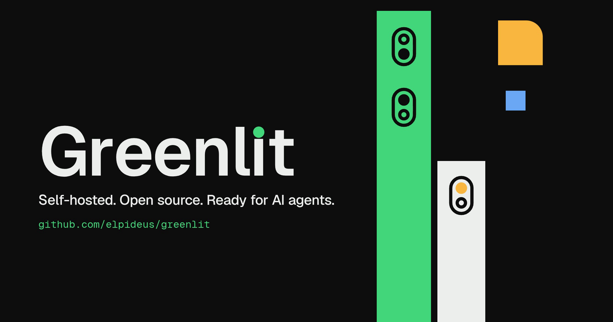
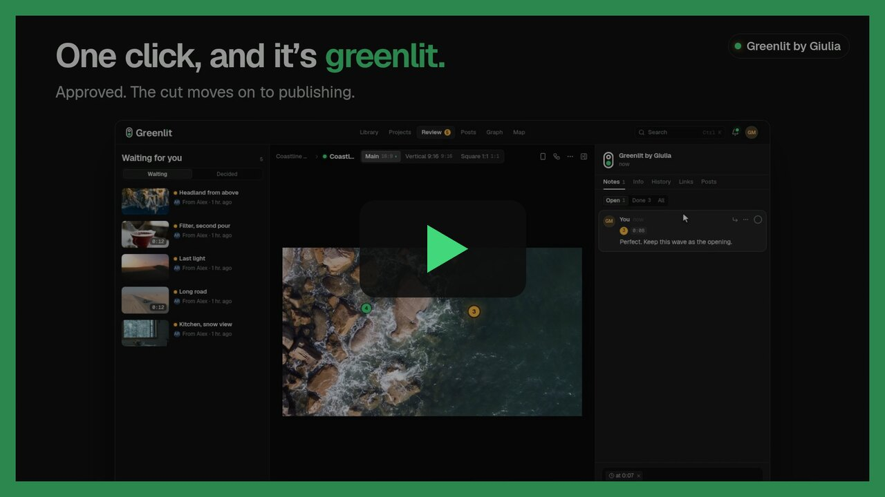
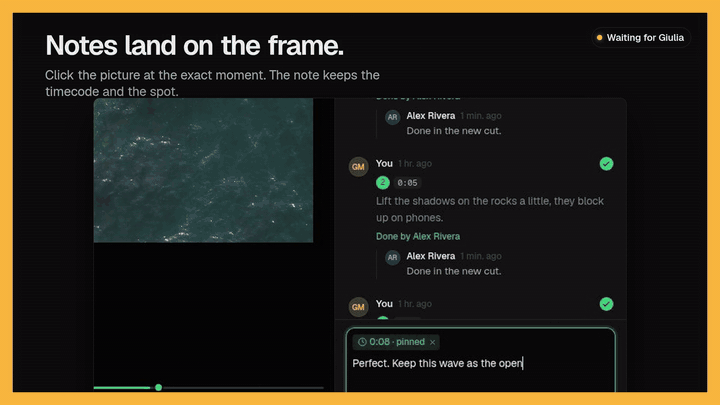
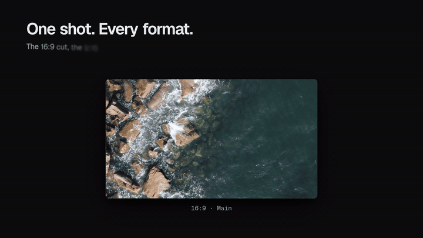
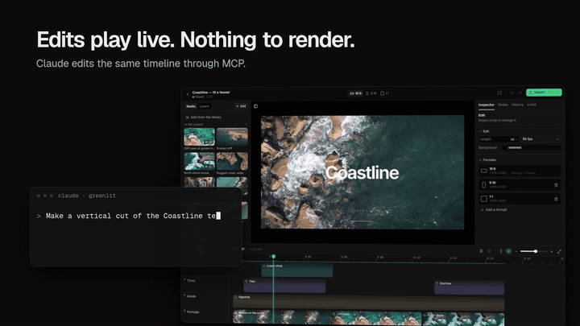
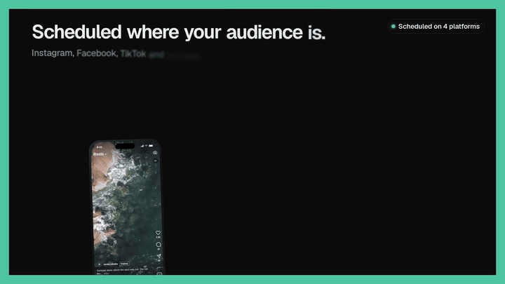

<p align="center">
  <a href="https://elpideus.github.io/greenlit/"></a>
</p>

<h3 align="center">Footage, review and publishing for studios that film their work.</h3>

<p align="center">
  A self-hosted media library, review room, social publishing desk and live-preview video editor,<br>
  built so people and AI agents (Claude Code first) work in it side by side.
</p>

<p align="center">
  <a href="https://elpideus.github.io/greenlit/"><b>Website</b></a> ·
  <a href="https://elpideus.github.io/greenlit/#film">Watch the film</a> ·
  <a href="https://elpideus.github.io/greenlit/start/">Get started</a> ·
  <a href="docs/">Docs</a>
</p>

<p align="center">
  <a href="https://elpideus.github.io/greenlit/"></a>
  <a href="https://elpideus.github.io/greenlit/#film"></a>
  <br>
  <a href="LICENSE"></a>
  <a href="https://github.com/elpideus/greenlit/actions/workflows/ci.yml"></a>
  <a href="docs/MCP.md"></a>
  <a href="docs/MCP.md"></a>
  <a href="docs/DOCKER.md"></a>
  
</p>

<br>

<p align="center">
  <a href="https://elpideus.github.io/greenlit/#film"></a>
</p>

---

## Why

Footage sits in one app. Notes arrive in a chat. Edits live somewhere else, and posts go out through four more.
**Greenlit puts the work, the decisions and the publishing in one quiet room, on your own server.** The name is the
moment a piece of work is approved and goes out, and the mark is a signal with two lamps: the upper one holds, the
lower one lights green. The same lamp tells the state of everything in the app.

## Notes land on the frame



Reviewers click the picture at the exact moment to leave a note, or drag to mark an area. They attach media, files
or pasted pictures, and greenlight the work or ask for changes as a checklist that can't be sent empty. Admins tick
notes off, send work for review, approve it themselves and hide items from specific reviewers. A single-use share
link lets a client review from their phone.

## One shot, every format



A media item holds every shape of the same content (the 16:9 film, the 9:16 reel, the 1:1 post) instead of
near-duplicate files. **Versions** combine (Language: English | Italiano × Watermark: with | without, each with its
own formats) and extra **audio tracks** ride along for a voice-over in another language. Thumbnails, hover-scrub
previews, waveforms, EXIF dates and places are made on upload. Search understands tokens (`status:`, `kind:`,
`#tag`, `project:`, `place:`), and everything has a right-click menu.

## Edits play live, with Claude



A lightweight timeline where compositions play in the browser **without rendering**: video, pictures, audio, text,
shapes and code layers (any HTML, CSS or JS animation, seeked frame by frame), keyframes, transitions and per-format
reframing. Claude edits the same document through MCP and every open editor updates instantly; the page also exposes
`window.greenlit.editor` for browser agents. Exports are frame-exact and land in the library as formats of one item.

## Scheduled where your audience is



Posts for **Instagram, Facebook, TikTok and YouTube** with per-platform captions, titles, tags, covers,
translations, music from each platform's own library, audio mix and options. Files are re-encoded with each
placement's preferred settings, previews emulate each app, and schedules are held **on the platforms themselves**.
A calendar shows everything and edits flow both ways. You sign in with the accounts you already use, with no
developer apps ([docs/CONNECTORS.md](docs/CONNECTORS.md)).

## And everything around the work

|                      |                                                                                                                                                             |
| -------------------- | ----------------------------------------------------------------------------------------------------------------------------------------------------------- |
| **History**          | Titles, notes, tags, formats, files, posts and edits keep a full history you can compare, name, annotate and restore.                                       |
| **Brand kits**       | Drop a kit's folder or .zip: Greenlit reads its palette, fonts and logos and shows it as a brand book. Claude reads it through MCP.                         |
| **Map and globe**    | Projects and media where they were shot, on an interactive map with a 3D globe and animated search.                                                         |
| **Production graph** | Every photo, still, clip and film, and how one became the next.                                                                                             |
| **Viewers**          | Code with syntax highlighting, Markdown and HTML pages, PDFs, depth maps, and [FigCraft](https://github.com/storytold/figcraft) designs live in the viewer. |
| **Share links**      | Single-use links that sign a person in to one post, item or project, with an expiry.                                                                        |
| **Storage**          | A usage overview and automatic archival of old media, one file at a time, keeping thumbnails and previews browsable.                                        |
| **Your brand**       | Theme packs (palettes, fonts, radius), your name, logos, favicon and sign-in picture, platform time zone, English and Italian.                              |
| **API and MCP**      | A documented REST API (OpenAPI at `/api/openapi.json`, reference at `/api/docs`) and an MCP server at `/api/mcp` with 67 tools.                             |

## Quick start

```bash
git clone https://github.com/elpideus/greenlit && cd greenlit
cp .env.example .env        # set GREENLIT_SECRET (openssl rand -hex 32), GREENLIT_PUBLIC_URL, CLOUDFLARE_TUNNEL_TOKEN
docker compose up -d --build
docker compose logs app | grep "setup code"
```

One compose project runs everything: the app, its database, Greenlit's own Android device (an emulator with a
virtual camera, for what only a platform's Android app does) and, when `.env` has a token, the Cloudflare Tunnel. It
all restarts by itself; run the same command again after an update. Greenlit publishes no port on the computer: it
is reachable only through the tunnel. Create the first admin with the one-time setup code, then invite people in
**Settings → People**. See [docs/DOCKER.md](docs/DOCKER.md).

### Connect Claude Code

Create a token in **Settings → API & MCP**, then:

```bash
claude mcp add --transport http greenlit https://your-greenlit/api/mcp --header "Authorization: Bearer glt_…"
```

Ask Claude to "make a 15-second vertical teaser from the drone shots in the Coastline project" and watch the editor.
More in [docs/MCP.md](docs/MCP.md).

## Development

```bash
pnpm install
docker compose -f docker/compose.dev.yaml up -d    # Postgres on :54329
pnpm dev                                           # API on :4310, web on :4300
```

Or everything in containers, with hot reload: `docker compose -f docker/compose.dev.yaml --profile app up`.

Greenlit is built to be changed one part at a time. The server is made of **modules** and the web app of
**features**, each one folder, discovered automatically and talking to the rest only through services, hooks,
events, UI slots and menu contributions: add, change or remove a part without touching the others
([docs/ARCHITECTURE.md](docs/ARCHITECTURE.md)). The design system and brand rules are in
[docs/DESIGN.md](docs/DESIGN.md).

|                         |                                                                                                                                  |
| ----------------------- | -------------------------------------------------------------------------------------------------------------------------------- |
| `apps/server`           | Hono API, Drizzle + Postgres, pg-boss jobs, WebSocket realtime, MCP                                                              |
| `apps/web`              | React 19, Vite, Tailwind 4, Base UI, Motion, TanStack Query, MapLibre                                                            |
| `packages/composition`  | the editing-project document model and ops                                                                                       |
| `packages/player`       | the stage that draws compositions (preview and export)                                                                           |
| `packages/platforms`    | social platform specs, limits and encoding presets                                                                               |
| `packages/api-anything` | a fork of [api-anything](https://github.com/goodnight000/api-anything) (MIT) with uploads: the platforms' own requests over HTTP |
| `site`                  | the website, an Astro project published to GitHub Pages                                                                          |
| `themes/`               | built-in theme packs                                                                                                             |
| `brand/`                | the Greenlit brand kit                                                                                                           |

## Say hello

Want Greenlit running for your studio, a feature built for your team, or just to say hi? Get in touch through
[the website](https://elpideus.github.io/greenlit/#contact), [elpideus.com](https://elpideus.com) or
[Instagram](https://instagram.com/elpideus).

## License

Copyright © 2026 the Greenlit contributors.

Greenlit is free software: you can redistribute it and/or modify it under the terms of the GNU General Public
License as published by the Free Software Foundation, either **version 3 of the License, or (at your option) any
later version**. See [LICENSE](LICENSE).

The Docker image includes [FigCraft](https://github.com/storytold/figcraft)'s browser build and `figcraft-cli`
(MIT OR Apache-2.0, with fonts under the SIL Open Font License), unmodified, with their licences in `/opt/figcraft`.
The footage in the screenshots and films is stock from [Pexels](https://www.pexels.com) under the Pexels licence;
the studio, people and accounts shown are fictional. The film's music is "Tech Background Music for Product Videos &
Commercials" by Music_Mania on [Pixabay](https://pixabay.com/music/build-up-scenes-tech-background-music-for-product-videos-amp-commercials-383623/)
(Pixabay Content License); its sound effects are recorded Foley from Pixabay.
